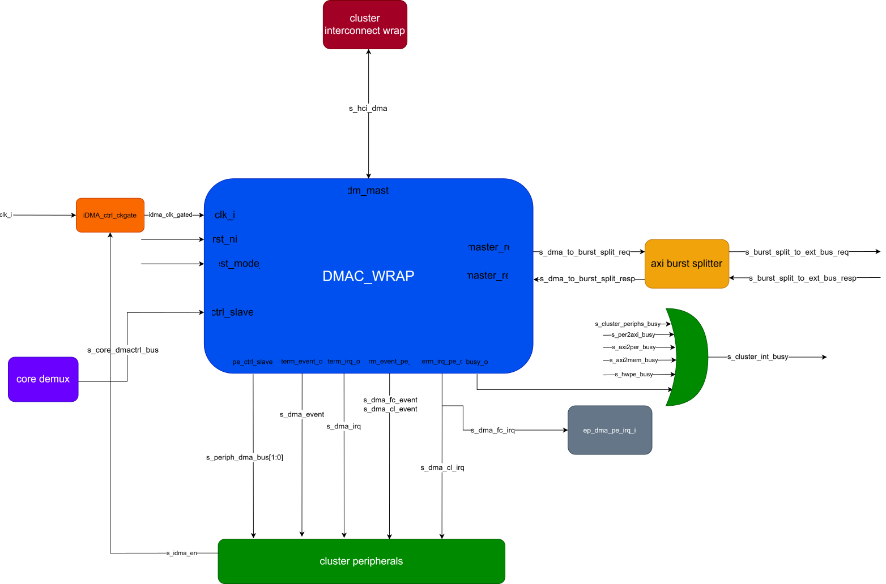

# Integration in Pulp Cluster

Currently, the iDMA is instantiated within the pulp cluster as follows:

- 10 control ports, each with its own register set:
    - 8 Cores
    - 2 PE
- 1 Bidirectional Stream:
    - This is to be intended as two physical channels that can work in parallel towards L1 and towards L2.
- Fifo Depth set to 8:
    - This means that up to 8 transfer configurations can be saved for each direction --> 16 total transfers can be configured into the iDMA at the same time.
- Clock gating:
    - The clock gating cell is controlled by the cluster control unit. This allows to completely shut down the iDMA clock, thus achieving lower power consumption when the IP is not being used.
    - A second, hardware-controlled clock gating cell inside the iDMA gates its datapath (see [iDMA Top Architecture](arch.md)).
- Burst Length:
    - The `IDMA_BURST_LENGTH` RTL parameter specifies the maximum length of the AXI bursts. It is set to 5, which with the 64-bit AXI data width gives bursts of at most 2^(3+5) = 256 bytes (32 beats). Bursts never cross a 4 KiB boundary either. The parameter applies to both directions.

## Pulp Cluster integration scheme

