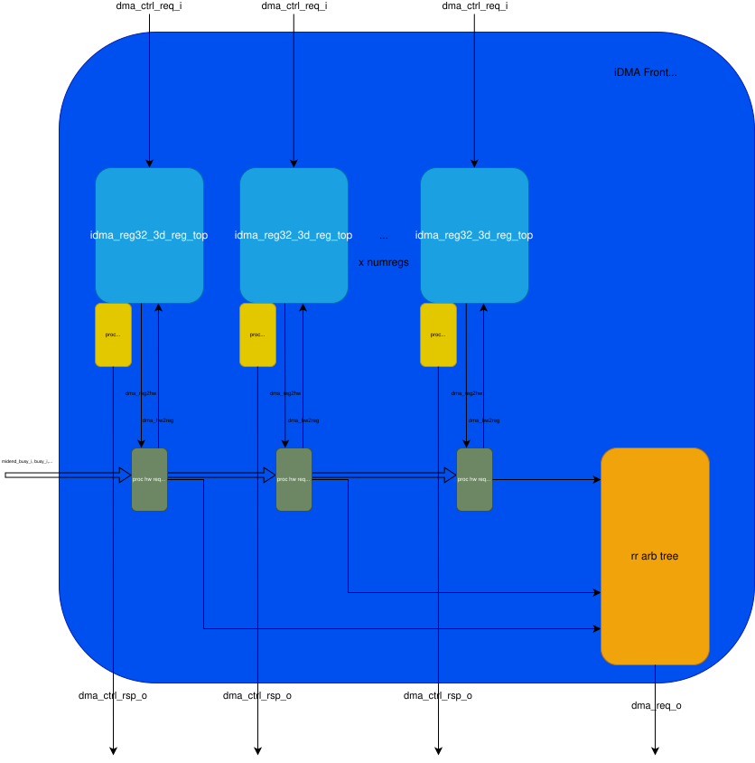
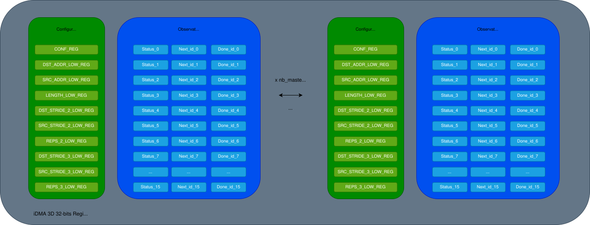

# iDMA FRONTEND

Structured as follows:

- Register sets
- Some binding logic for requests from the register set to the rest of the iDMA and viceversa
- Round Robin arbiter tree that arbitrates between the register sets that launch a transfer at the same time and dispatches each transfer to the channel (stream) it was launched on



## iDMA Register Top

The register set for iDMA is structured as follows:


So, for each master of the iDMA (generally 8 cores + 2 PE), the following are available:

- Configuration registers:
    - These include all the transfer parameters + protocols
- Observational registers:
    - For each physical channel of the iDMA (so 2 in the current iDMA instantiation inside the pulp cluster), a triplet of observational registers is made available: status, next ID and done ID. These are necessary for synchronization, arbitrating the transfers and waiting on them.

Register widths:

- CONF_REG: 18 bits used (bits 31:18 are reserved)
- Transfer parameters registers: 32 bits
- Observational registers: STATUS 10 bits, NEXT_ID and DONE_ID 32 bits

## Registers

Offsets are in bytes, relative to the base of the register set of each master. Every register
resets to 0, except NEXT_ID (2) and DONE_ID (1).

| Register              | Offset    | Bitwidth  | Access | Fields                                                        |
| --------              |-------    | -------   | ------ | -------                                                       |
| CONF_REG              | 0x000     |   18      | RW     | See below: decouple options, reduce max len options, dimensions, protocol options |
| STATUS_0_REG          | 0x004     |   10      | RO     | Busy flags of stream 0: bit 9 midend busy, bits 8:0 backend busy |
| STATUS_1_REG          | 0x008     |   10      | RO     | Busy flags of stream 1, same layout                           |
| NEXT_ID_0_REG         | 0x00c     |   32      | RO     | Reading it launches the configured transfer on stream 0 and returns its ID |
| NEXT_ID_1_REG         | 0x010     |   32      | RO     | Reading it launches the configured transfer on stream 1 and returns its ID |
| DONE_ID_0_REG         | 0x014     |   32      | RO     | ID of the last transfer completed on stream 0                 |
| DONE_ID_1_REG         | 0x018     |   32      | RO     | ID of the last transfer completed on stream 1                 |
| USER_HIGH_REG         | 0x01c     |   32      | RW     | User field, not used by the pulp cluster instance             |
| USER_LOW_REG          | 0x020     |   32      | RW     | User field, not used by the pulp cluster instance             |
| DST_ADDR_LOW_REG      | 0x0d0     |   32      | RW     | Starting address at the destination memory region             |
| SRC_ADDR_LOW_REG      | 0x0d8     |   32      | RW     | Starting address at the source memory region                  |
| LENGTH_LOW_REG        | 0x0e0     |   32      | RW     | Length in bytes of the transfer (of one row for 2D/3D)        |
| DST_STRIDE_2_LOW_REG  | 0x0e8     |   32      | RW     | 2D stride parameter at the destination memory region          |
| SRC_STRIDE_2_LOW_REG  | 0x0f0     |   32      | RW     | 2D stride parameter at the source memory region               |
| REPS_2_LOW_REG        | 0x0f8     |   32      | RW     | 2D repetitions parameter                                      |
| DST_STRIDE_3_LOW_REG  | 0x100     |   32      | RW     | 3D stride parameter at the destination memory region          |
| SRC_STRIDE_3_LOW_REG  | 0x108     |   32      | RW     | 3D stride parameter at the source memory region               |
| REPS_3_LOW_REG        | 0x110     |   32      | RW     | 3D repetitions parameter                                      |

CONF_REG fields:

| Bits  | Field          | Meaning                                                                 |
| ----- | -------------- | ----------------------------------------------------------------------- |
| 0     | decouple_aw    | Decouple the read channel from the AXI write address channel            |
| 1     | decouple_rw    | Decouple the read channel from the write channel                        |
| 2     | src_reduce_len | Limit the source (read) burst length to `src_max_llen`                  |
| 3     | dst_reduce_len | Limit the destination (write) burst length to `dst_max_llen`            |
| 6:4   | src_max_llen   | Maximum source burst length, logarithmic                                |
| 9:7   | dst_max_llen   | Maximum destination burst length, logarithmic                           |
| 11:10 | enable_nd      | Number of dimensions: 0 = 1D, 1 = 2D, 2 = 3D                            |
| 14:12 | src_protocol   | Source protocol: 0 = AXI, 1 = OBI, 4 = INIT (reads zeros)               |
| 17:15 | dst_protocol   | Destination protocol: 0 = AXI, 1 = OBI, 4 = INIT (discards the data)    |

Register accesses need all byte enables set (for CONF_REG, at least the three lower bytes). An access with
other byte enables, or to an offset not listed above, gets an error response. The register set
decodes the lower 9 address bits, so it repeats every 512 bytes.

## Launching a transfer and waiting for it

A master writes the transfer parameters and CONF_REG into its own register set, then reads
NEXT_ID of the stream that serves the direction (see [Protocol configuration](../um/sim.md#protocol-configuration)).
The read launches the transfer and returns its ID. If the stream's FIFO is full, or another
master is launching in the same cycle, the read is stalled until the transfer can be accepted.
The parameters stay in the registers, so the next launch can reuse them.

The IDs of each stream start at 2 after reset (DONE_ID starts at 1) and increase by one at every
launch. After 0xFFFFFFFF they continue at 1: 0 is never returned. The transfers of one stream
complete in launch order, so a transfer is complete once DONE_ID has reached its ID. Because the IDs
wrap, compare them as `(int32_t)(done_id - id) >= 0` rather than with `done_id >= id`.

## Current configurations

In the pulp-sdk and pulp-runtime sw stacks we're configuring the iDMA as follows:

```

#define IDMA_DEFAULT_CONFIG 0x0
#define IDMA_DEFAULT_CONFIG_L1TOL2 (IDMA_DEFAULT_CONFIG | (IDMA_PROT_OBI << IDMA_REG32_3D_CONF_SRC_PROTOCOL_OFFSET) | (IDMA_PROT_AXI << IDMA_REG32_3D_CONF_DST_PROTOCOL_OFFSET))
#define IDMA_DEFAULT_CONFIG_L2TOL1 (IDMA_DEFAULT_CONFIG | (IDMA_PROT_AXI << IDMA_REG32_3D_CONF_SRC_PROTOCOL_OFFSET) | (IDMA_PROT_OBI << IDMA_REG32_3D_CONF_DST_PROTOCOL_OFFSET))
#define IDMA_DEFAULT_CONFIG_L1TOL1 (IDMA_DEFAULT_CONFIG | (IDMA_PROT_OBI << IDMA_REG32_3D_CONF_SRC_PROTOCOL_OFFSET) | (IDMA_PROT_OBI << IDMA_REG32_3D_CONF_DST_PROTOCOL_OFFSET))

#define IDMA_DEFAULT_CONFIG_2D 0x400
#define IDMA_DEFAULT_CONFIG_L1TOL2_2D (IDMA_DEFAULT_CONFIG_2D | (IDMA_PROT_OBI << IDMA_REG32_3D_CONF_SRC_PROTOCOL_OFFSET) | (IDMA_PROT_AXI << IDMA_REG32_3D_CONF_DST_PROTOCOL_OFFSET))
#define IDMA_DEFAULT_CONFIG_L2TOL1_2D (IDMA_DEFAULT_CONFIG_2D | (IDMA_PROT_AXI << IDMA_REG32_3D_CONF_SRC_PROTOCOL_OFFSET) | (IDMA_PROT_OBI << IDMA_REG32_3D_CONF_DST_PROTOCOL_OFFSET))
#define IDMA_DEFAULT_CONFIG_L1TOL1_2D (IDMA_DEFAULT_CONFIG_2D | (IDMA_PROT_OBI << IDMA_REG32_3D_CONF_SRC_PROTOCOL_OFFSET) | (IDMA_PROT_OBI << IDMA_REG32_3D_CONF_DST_PROTOCOL_OFFSET))

#define IDMA_DEFAULT_CONFIG_3D 0x800
#define IDMA_DEFAULT_CONFIG_L1TOL2_3D (IDMA_DEFAULT_CONFIG_3D | (IDMA_PROT_OBI << IDMA_REG32_3D_CONF_SRC_PROTOCOL_OFFSET) | (IDMA_PROT_AXI << IDMA_REG32_3D_CONF_DST_PROTOCOL_OFFSET))
#define IDMA_DEFAULT_CONFIG_L2TOL1_3D (IDMA_DEFAULT_CONFIG_3D | (IDMA_PROT_AXI << IDMA_REG32_3D_CONF_SRC_PROTOCOL_OFFSET) | (IDMA_PROT_OBI << IDMA_REG32_3D_CONF_DST_PROTOCOL_OFFSET))
#define IDMA_DEFAULT_CONFIG_L1TOL1_3D (IDMA_DEFAULT_CONFIG_3D | (IDMA_PROT_OBI << IDMA_REG32_3D_CONF_SRC_PROTOCOL_OFFSET) | (IDMA_PROT_OBI << IDMA_REG32_3D_CONF_DST_PROTOCOL_OFFSET))

```