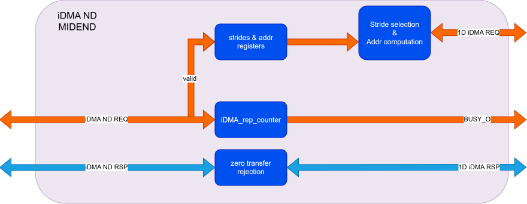

# iDMA MIDEND

This part of the iDMA is responsible for handling multi-dimensional transfers:

- The multi-dimensional transfers are split into 1-dimensional transfers and then sent to the backend for execution.

An iDMA midend module is instantiated for each stream, i.e. two for each bidirectional stream (one towards L2 and one towards L1).

The midend issues one 1D transfer of `length` bytes for each row. After a row that is not the last one of its 2D page, it adds the 2D strides to the source and destination addresses of that row. After the last row of a page, it adds the 3D strides instead, again to the addresses of that last row. A dimension whose repetitions are 0 is executed once (it is bypassed). A transfer that moves no data (length 0, or 0 repetitions in every dimension) issues nothing to the backend, and is completed by the midend only after all the earlier transfers of the stream have completed, so completions stay in launch order.

## Note

This portion of the iDMA is gated by the rtl-controlled clock gating cell inside the iDMA wrapper, meaning it's clocked only when actually needed for a transfer along the specified direction.

## Scheme

